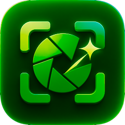
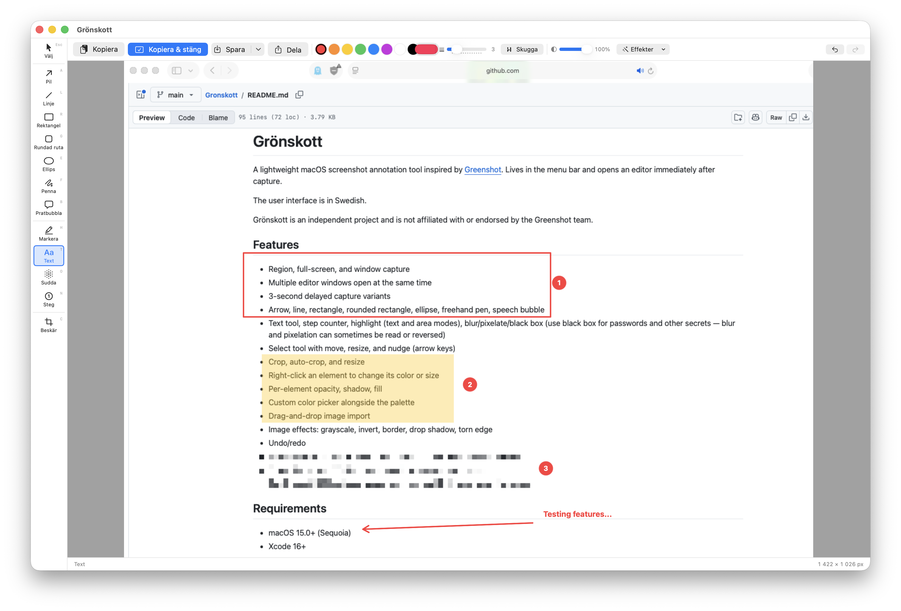

<p align="center"></p>

# Grönskott

A lightweight macOS screenshot annotation tool inspired by [Greenshot](https://getgreenshot.org). Lives in the menu bar and opens an editor immediately after capture.

The user interface is in Swedish.

Grönskott is an independent project and is not affiliated with or endorsed by the Greenshot team.



## Features

- Region, full-screen, and window capture
- Multiple editor windows open at the same time
- 3-second delayed capture variants
- Arrow, line, rectangle, rounded rectangle, ellipse, freehand pen, speech bubble
- Text tool, step counter, highlight (text and area modes), blur/pixelate/black box (use black box for passwords and other secrets — blur and pixelation can sometimes be read or reversed)
- Select tool with move, resize, and nudge (arrow keys)
- Crop, auto-crop, and resize
- Right-click an element to change its color or size
- Per-element opacity, shadow, fill
- Custom color picker alongside the palette
- Drag-and-drop image import
- Image effects: grayscale, invert, border, drop shadow, torn edge
- Undo/redo
- Export as PNG or JPEG, copy to clipboard, or copy and close in one step
- Share via the macOS share menu (Mail, Messages, AirDrop, …)
- Quick save (⌘S) to a folder you choose once, with timestamped file names

## Requirements

- macOS 15.0+ (Sequoia)
- Xcode 16+

## Build

```bash
xcodebuild -project Gronskott.xcodeproj -scheme Gronskott -destination "platform=macOS" build
open ~/Library/Developer/Xcode/DerivedData/Gronskott-*/Build/Products/Debug/Gronskott.app
```

Or open `Gronskott.xcodeproj` in Xcode and press ⌘R.

The app does not appear in the Dock — look for the camera icon in the menu bar.

## First run

macOS will prompt for Screen Recording permission. Go to **System Settings → Privacy & Security → Screen Recording** and enable Grönskott.

Tip: select your own team under **Signing & Capabilities** in Xcode (or pass `DEVELOPMENT_TEAM=<your team ID>` to `xcodebuild`). Without a team the app is only ad-hoc signed, and macOS forgets the Screen Recording permission every time you rebuild.

## Menu bar actions

- Take a region screenshot (`⌃⇧3`)
- Take a full-screen screenshot (`⌃⇧4`)
- Take a window screenshot (`⌃⌥5`)
- Take a region or full-screen screenshot after a 3-second delay
- Toggle **Starta med macOS** to start Grönskott automatically when you log in

## Security note

**App Sandbox is disabled** (`ENABLE_APP_SANDBOX = NO` in the build settings). This is required because `SCScreenshotManager` does not work inside the sandbox without a provisioning profile. The app makes no network requests and does not access any files outside of what you explicitly open or save via standard system dialogs. You can verify this by inspecting the source — there are no entitlements for network access, file bookmarks, or any other elevated permissions beyond screen recording.

If you intend to distribute this outside of direct builds (e.g. via the Mac App Store), you will need a provisioning profile and to re-enable the sandbox.

## Keyboard shortcuts

| Key | Action |
|-----|--------|
| ⌃⇧3 | Capture region |
| ⌃⇧4 | Capture full screen |
| ⌃⌥5 | Capture window |
| Esc | Select tool |
| A | Arrow |
| L | Line |
| R | Rectangle |
| G | Rounded rectangle |
| E | Ellipse |
| F | Freehand pen |
| B | Speech bubble |
| H | Highlight |
| T | Text |
| O | Blur/pixelate/black box |
| N | Step counter |
| C | Crop |
| ⌘C | Copy to clipboard |
| ⇧⌘C | Copy and close the editor |
| ⌘S | Save to the chosen folder |
| ⇧⌘S | Save as… |
| ⌘Z / ⇧⌘Z | Undo / redo |
| ⌘D | Duplicate selected element |
| Delete | Delete selected element |
| Arrow keys | Nudge selected element 1 px |
| ⇧ + arrow | Nudge 10 px |
